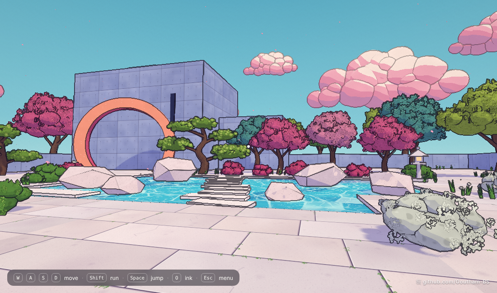

# Sakura Illustration

A small walkable garden built with three.js, styled like a Japanese anime background painting: cel shading, lilac shadows, hand-drawn ink outlines, cherry blossoms and pink clouds.

**Play it live:** https://goutham-bs.github.io/sakura-illustration/

## Run it

It's a single HTML file. three.js and the fonts load from a CDN, so you need an internet connection.

- Open `index.html` in Chrome, Edge or Firefox, or
- serve the folder locally: `npx serve .` and open the URL it prints.

## Controls

| Action | Keys |
| --- | --- |
| Move | `W` `A` `S` `D` or arrow keys |
| Look | Mouse (click to capture the pointer) |
| Run | `Shift` |
| Jump | `Space` |
| Toggle ink lines | `O` |
| Toggle line wobble | `B` |
| Menu | `Esc` |

On a phone, your left thumb moves and your right thumb looks around.

Things to try: wade into the pond, cross on the stepping stones, walk through the moon gate, and climb the concrete cubes.

## How the look is made

- **Toon shading:** `MeshToonMaterial` with a 3-step gradient, a lavender ambient light and a warm sun, so shadows read as lilac instead of grey.
- **Painterly surfaces:** an `onBeforeCompile` extension adds world-space mottling, speckles, sun-bleached tops and noise-jittered (leafy) shadow edges.
- **Foliage:** about 30k camera-facing leaf, needle and blossom cards from a canvas-drawn atlas, drawn in one instanced call, over darker canopy volumes.
- **Ink outlines:** a post pass detects edges from depth (Laplacian of inverse depth) and view normals, with a slight frame-stepped wobble so the lines look hand-drawn.
- **Water:** a shader with animated Voronoi caustics, foam around rocks, sun glints and reflections. It also receives shadows.
- **Textures:** paving stones and Ando-style concrete panels are painted procedurally on canvas at load time, so there are no image assets.

## Notes

- Rendering is three passes per frame: normals and depth, colour with shadows, then the ink composite. On a slow GPU the page drops its render resolution once by itself.
- Everything lives in `index.html`. To change the layout, edit the tree and rock calls in the `foliage` and `faceted boulders` sections.
